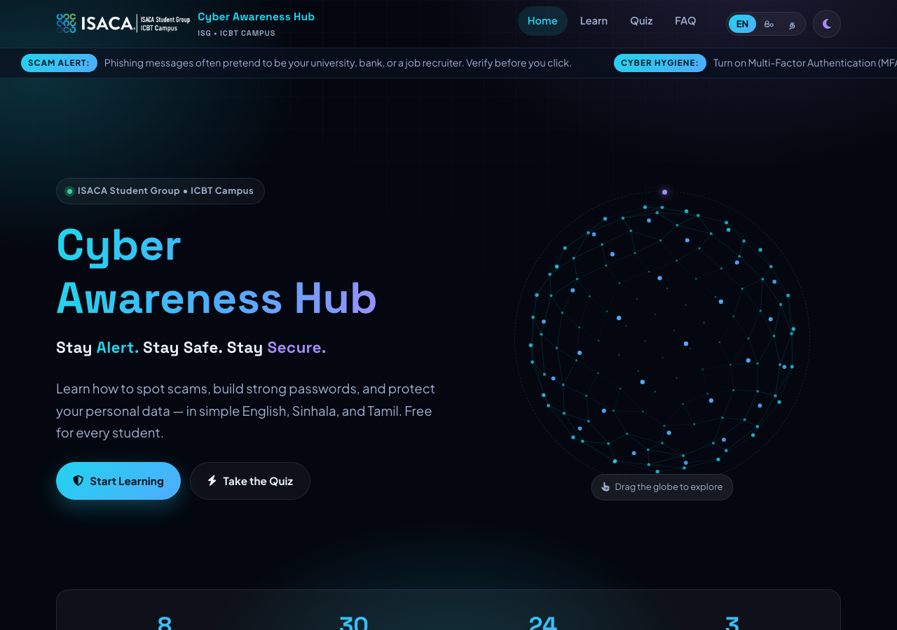

# Cyber Awareness Hub — Exito

🚀 **[Open the live site](https://ridma-kithara.github.io/Cyber-Awareness-Hub-Exito-/)**


<p align="center">
  
</p>

A free, tri-lingual (English / සිංහල / தமிழ்) cyber-security education platform built by the **ISACA Student Group of ICBT Campus**. It teaches students how to recognize phishing, scams, weak passwords and privacy mistakes — in simple language, with honest content only.

## What's inside

| Page | Purpose |
| --- | --- |
| `index.html` | Hero with a hand-built 3D network globe, real-count stats, topic grid and a searchable question engine |
| `learn.html` | **Threat Library** — 8 core topics, each with warning signs, defenses and an interactive *Scam or Safe?* check |
| `quiz.html` | 10-question quiz with instant feedback, explanations, score ring and answer review |
| `faq.html` | 30 essential questions with filters and language-aware search |
| `404.html` | GitHub Pages–compatible not-found page |

Everything runs on **vanilla HTML/CSS/JS** — no build step, no frameworks, no third-party requests at runtime (approved for GitHub Pages as-is).

## Quick start

Open locally (any static server works):

```bash
python3 -m http.server 8000
# → http://localhost:8000
```

Or just open `index.html` in a browser.

## Deploy on GitHub Pages

1. Push the repository to GitHub.
2. Repo → **Settings** → **Pages** → *Deploy from a branch*.
3. Choose branch **`master`**, folder **`/ (root)`**, save.
4. The site is served at `https://<username>.github.io/<repo>/` — all assets, fonts and scripts are relative paths, so it works from any sub-path without configuration.

(The `.nojekyll` file disables Jekyll processing so underscore-prefixed vendor assets are served untouched.)

## Features

- **Trilingual, first-class.** English, Sinhala and Tamil across every string — UI copy, topics, FAQ bank and quiz bank — switchable instantly, persisted in `localStorage`, with `lang`/`font` switching on `<html>`.
- **Interactive 3D hero.** A fibonacci-sphere "network globe" drawn with the Canvas 2D API (no WebGL/Three.js): perspective, depth fade, drag with inertia. Animation pauses when the tab is hidden or scrolled away, respects `prefers-reduced-motion`, and falls back to a static frame.
- **Dark + light themes.** Glassmorphism surfaces, gradient accents, scroll reveals — all tokenized via CSS custom properties.
- **Searchable knowledge.** A keyword-scoring search engine over the 24-category topic bank (preserved from the original project engine), plus searchable/filterable 30-question FAQ.
- **Accessible accordion & flows.** Real `<button aria-expanded>` toggles, skip link, focus-visible outlines, `aria-current` page links, `aria-live` result regions, keyboard-friendly everything.

## Security notes

- **Strict Content-Security-Policy** (meta): `default-src 'self'; script-src 'self'; style-src 'self'; img-src 'self' data:; font-src 'self'; connect-src 'self'; object-src 'none'; base-uri 'self'; form-action 'self'; frame-src 'none'` — the site loads **zero** third-party resources.
- **No privileged secrets of any kind** are embedded; the site is 100% static and client-side.
- **XSS-safe rendering:** all dynamic content is inserted with `textContent` (never `innerHTML` from data), colors are passed through CSS custom properties, and no inline event handlers exist. Search queries are only read, never interpreted as markup.
- **Fonts, icons and scripts are self-hosted** (Font Awesome subset + Google-fonts woff2 files in `assets/fonts/`), avoiding supply-chain and tracking exposure.

## Project structure

```
├── index.html            # home (globe hero, topics, search, quiz teaser)
├── learn.html            # Threat Library (8 topics + habits)
├── quiz.html             # quiz flow (pick → run → result)
├── faq.html              # 30-question FAQ
├── 404.html              # not-found page
├── docs/screenshots/     # screenshots used by this README & the Wiki
├── .nojekyll             # bypass GitHub Pages Jekyll
└── assets/
```

📚 **[Full documentation in the Wiki →](https://github.com/Ridma-kithara/Cyber-Awareness-Hub-Exito-/wiki)** — site guide, security notes, and how to edit the trilingual content.

## Content policy

All educational content — including the 30-question FAQ and the searchable topic bank — is preserved from the original Cyber Awareness Hub project. The quiz contains original trilingual questions aligned with the same lessons. The site deliberately contains **no fabricated statistics or claims**: the stat strip shows only the site's real counts (8 topics / 30 FAQ / 24 quiz questions / 3 languages), and any third-party figure (e.g. MFA effectiveness) is attributed to its source.

## Credits

Built by the **ISACA Student Group — ICBT Campus** for student awareness. Follow [ISACA](https://www.linkedin.com/company/isaca) and work with your institution's official guidance for security incidents.
